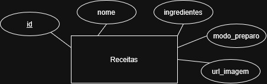

# Backend Receitas Flutter

API de receitas feita com Node.js, Express, Prisma e MySQL para consumo no Flutter.

## Testar localmente

1. Crie um banco de dados MySQL, por exemplo `flutter_receitas`.
2. No terminal, entre na pasta da API:

   ```bash
   cd api
   ```

3. Crie ou ajuste o arquivo `.env`:

   ```env
   PORT=3000
   DATABASE_URL="mysql://root@localhost:3306/flutter_receitas?schema=public&timezone=UTC"
   ```

4. Instale as dependências, crie a tabela e inicie o servidor:

   ```bash
   npm install
   npx prisma migrate dev --name init
   npx prisma generate
   npm run dev
   ```

5. Rode:

```bash
npm run dev
```
ou 

```bash
node server.js
```

5. Teste a API em `http://localhost:3000`.

## Rotas

| Método | Rota | Ação |
| --- | --- | --- |
| GET | `/` | Testa se a API está online |
| GET | `/receitas/listar` | Lista as receitas |
| POST | `/receitas/cadastrar` | Cadastra uma receita |
| PUT | `/receitas/atualizar/:id` | Atualiza uma receita |
| DELETE | `/receitas/excluir/:id` | Exclui uma receita |

## Testar com Insomnia

O arquivo `docs/Insomnia_2026-10-14-11-30-53.yaml` contém a coleção **Flutter Receitas API**.

1. Inicie a API com `npm run dev` dentro da pasta `api`.
2. No Insomnia, use **Import** e selecione o arquivo `.yaml` da pasta `docs`.
3. Abra a coleção **Flutter Receitas API** para testar as requisições de listar, cadastrar, atualizar e excluir.
4. Nas rotas de atualizar e excluir, informe o `id` da receita no parâmetro da URL.

## DER

O diagrama entidade-relacionamento está em `docs/DER.jpg`. Ele apresenta a entidade `Receita` e os campos armazenados no banco: `id`, `nome`, `ingredientes`, `modo_preparo` e `url_imagem`.



Exemplo para cadastrar ou atualizar uma receita:

```json
{
  "nome": "Miojo",
  "ingredientes": "Um pacotinho",
  "modo_preparo": "Ferva a água e coloque o macarrão por dois minutos.",
  "url_imagem": "https://exemplo.com/miojo.jpg"
}
```
